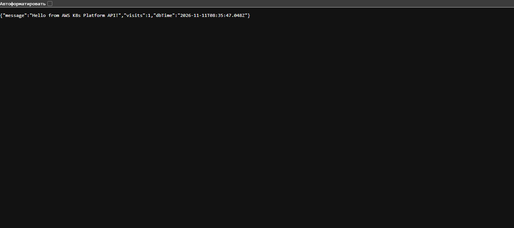

# AWS K8s Platform

Production-ready infrastructure and application deployment setup using Terraform, Kubernetes (EKS), Helm, and Node.js.

## Architecture
[ AWS VPC ] 
  ├── Public Subnets (NAT Gateway, AWS ALB Ingress)
  └── Private Subnets
        └── EKS Cluster (Kubernetes)
              ├── Node Group (t3.small)
              └── Pods (Node.js API + In-cluster PostgreSQL + In-cluster Redis)

*(Note: Ingress uses AWS ALB Controller for production-grade traffic routing).*

## Prerequisites & AWS Setup
1. Install tools: Terraform >= 1.0, AWS CLI, Helm v3, Docker.
2. Configure your AWS credentials by running: aws configure (ensure your region is set to ap-northeast-1).

## Project Structure
- app/ - Node.js Express backend API with PostgreSQL and Redis integration.
- helm/app-chart/ - Helm chart for deploying application, DB, Redis, and ALB Ingress.
- terraform/ - Terraform configuration for AWS VPC, EKS cluster, and cost management.
- .github/workflows/ - CI/CD pipelines for automated validation and AWS ECR image publishing.

## Configuration (.env.example)
Copy app/.env.example to app/.env and adjust variables if running locally.

## CI/CD Automation
- **CI Pipeline:** Automatically validates Terraform syntax and Helm charts on every push.
- **CD Pipeline:** Automatically builds the Docker image and pushes it to AWS ECR on every push to `main`.

## Cloud Deployment Guide (AWS EKS)

⚠️ COST WARNING: Running an EKS control plane costs ~$0.10/hour (~$72/month) plus node instances (t3.small) and NAT Gateway. Always destroy your infrastructure when not in use!

1. Deploy Infrastructure (Terraform): 
   cd terraform && terraform apply

2. Configure kubectl to connect to your EKS cluster: 
   aws eks update-kubeconfig --region ap-northeast-1 --name aws-k8s-platform-dev-cluster

3. Push Docker Image (Handled automatically by GitHub Actions CD pipeline after `git push`, or manually):
   cd app && docker build -t <account-id>.dkr.ecr.ap-northeast-1.amazonaws.com/aws-k8s-app:latest . && docker push ...

4. Deploy Application (Helm): 
   helm install my-app helm/app-chart

5. Get the external Ingress URL (ALB address):
   kubectl get ingress

6. Cleanup / Destroy (Save your money!): 
   cd terraform && terraform destroy

## 🛠️ Troubleshooting (Battle-Tested)

During the deployment of this project, several real-world infrastructure issues were encountered and resolved:

1. **Pod Limit Reached (`Too many pods`):** 
   - *Issue:* The `t3.micro` instance type hit the AWS ENI (Elastic Network Interface) limit, allowing only 4 pods per node.
   - *Resolution:* Upgraded the EKS Node Group to `t3.small`, which increased the IP limit and allowed application pods to schedule successfully.

2. **AWS Load Balancer Controller `AccessDenied`:** 
   - *Issue:* The Ingress controller could not provision an ALB due to missing IAM permissions on the EKS Node Group role.
   - *Resolution:* Downloaded the official AWS IAM policy for the controller, created a custom policy in IAM, and attached it to the Node Group's IAM role.

3. **502 Bad Gateway on ALB:** 
   - *Issue:* The ALB was reachable, but returned 502 errors because it couldn't route traffic to the backend.
   - *Resolution:* 
     - Fixed the Kubernetes Service `targetPort` to `3000` (matching the Node.js app) instead of `80`.
     - Injected missing `DATABASE_URL` and `REDIS_URL` environment variables into the Deployment manifest.
     - Configured custom ALB Health Check annotations (`/health`) to ensure the load balancer correctly identified healthy pods.